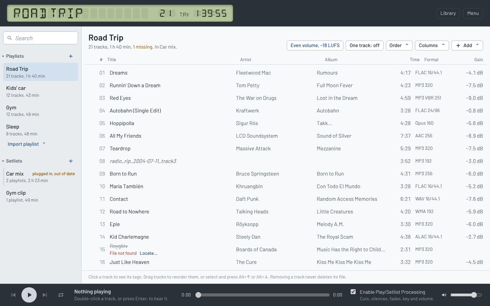
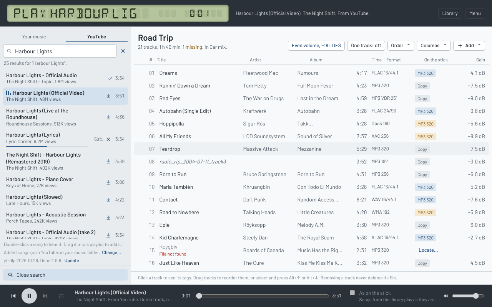
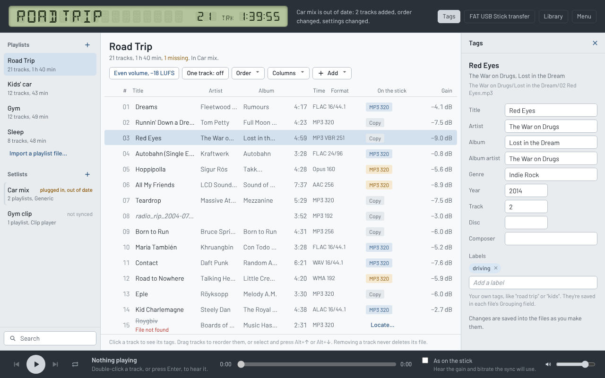
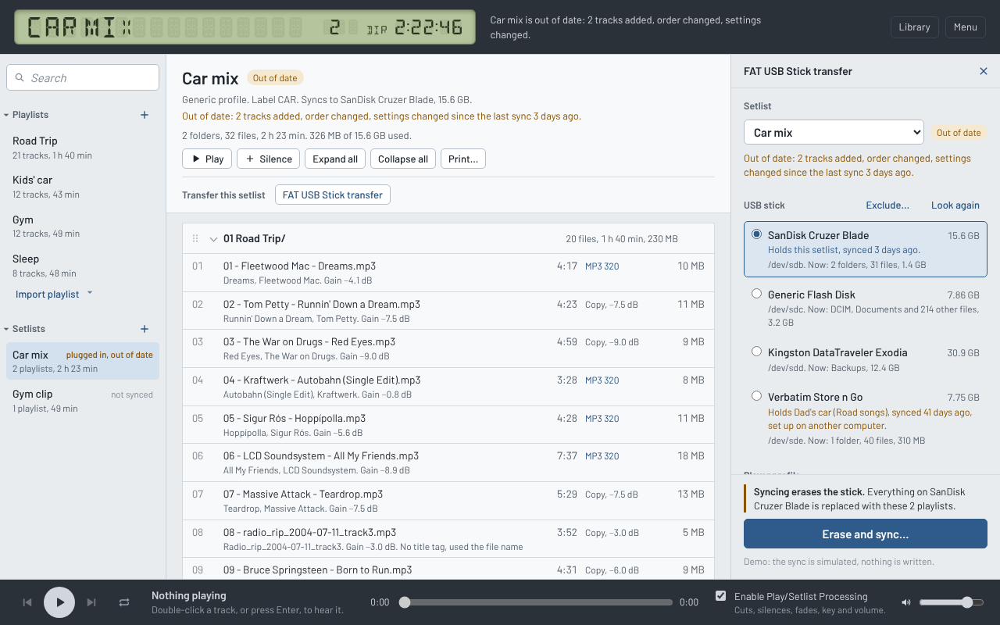
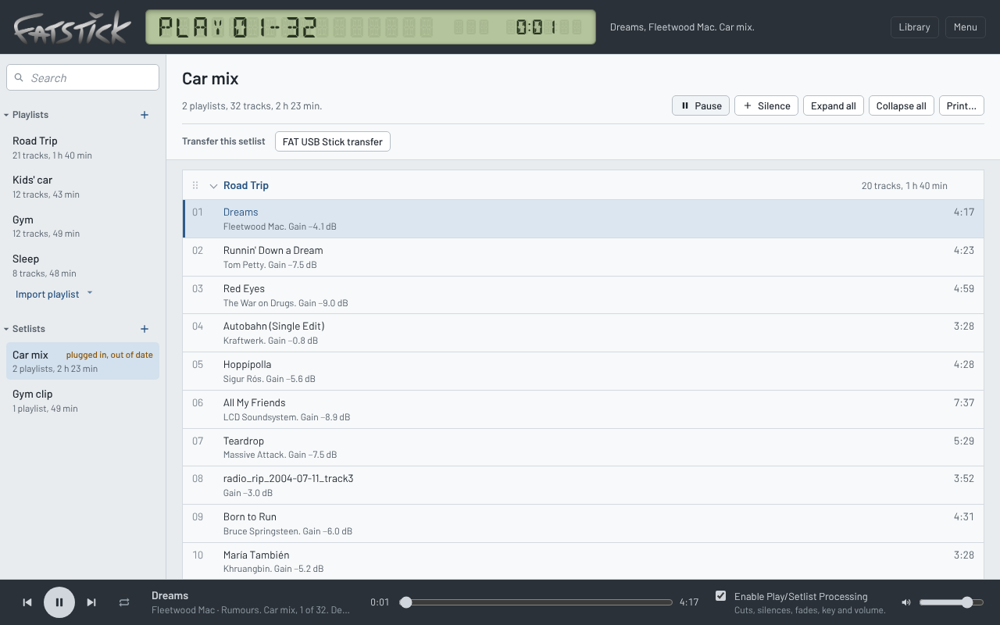
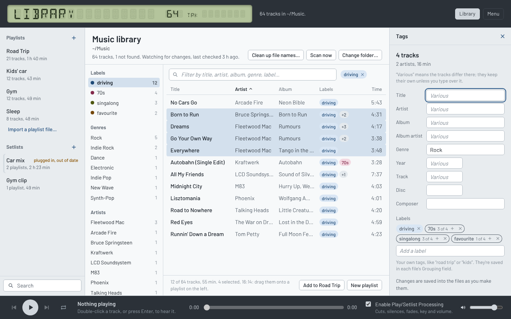
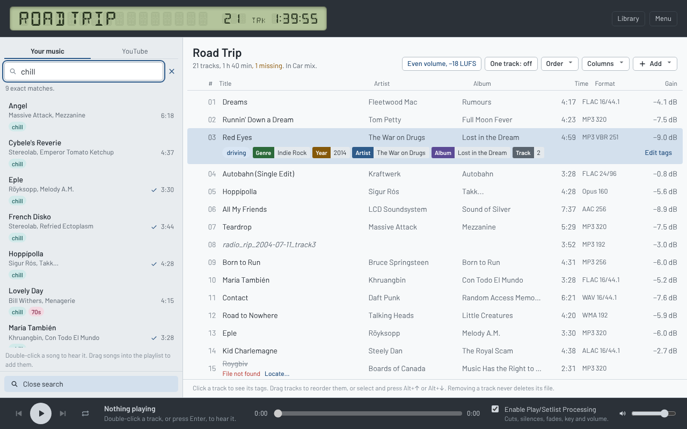

# Fatstick



A music player and playlist organizer for your own music folder. It also puts
your playlists onto a USB stick so that cheap MP3 players and car stereos play
them in playlist order. Those players play files in **FAT order**, not by name
or tag. FAT order is the order of the entries in each folder's table on the FAT
volume (what fatsort, YAFS and DriveSort sort). It is not stored in the File
Allocation Table itself, which only chains clusters.

A desktop app for Linux, Windows and macOS (Tauri v2), free software under the
GPL version 3 or later.

## What it does

- **Playlists.** Make them in the app, or import M3U/M3U8, XSPF (VLC) and PLS
  files; export as M3U8 or XSPF. Drop files and folders from the file manager. A
  folder is added in album order (disc, track number, then name). Moved or
  renamed files can be found again ("Locate"). Your music files only change
  when you change them in the library (tags as you edit them; file names
  after a preview), and nothing ever deletes them.
- **Your music library.** "Library" (top right) turns the middle of the
  window into your music folder: choose the folder once and the app reads
  every song in it, then keeps up as files are added, moved or retagged (it
  watches the folder, and "Scan now" is there too). You sort the files into
  folders yourself; the library is for finding and tagging them. Browse by
  your labels, genres, artists, albums and decades, or by what's missing (no
  genre, no labels, file not found); filter by typing; sort by any column;
  and drag tracks onto a playlist on the left. Double-click a track (or
  press Enter) to hear it on its own: it plays once and the player stops.
  Shift+Enter or the right-click menu adds it to the open playlist. Built for big folders on
  network drives: the scan reads each file's tags and stream facts (a few
  hundred KB), not every MP3 frame, and fills the library as it goes. A track
  is read in full in the background once it's in a playlist, as how it goes
  on a stick depends on every frame. On a network drive the watcher only
  hears of changes made from this computer, so the app also looks again when
  you come back to it after ten minutes away, and "Scan now" is always there.
  A file that's gone shows as "File not found" (browse by it under Missing
  tags); "Remove from the library" in its right-click menu (or Delete), or
  "Remove all from the library" when browsing by it, takes such tracks out.
  One a playlist still has stays there, where Locate can find its file
  again; if a file comes back, the next scan lists it again. A track's
  labels that don't fit its row show as "+2": hover it for all of them.
- **Tags, and labels of your own.** "Edit tags" on a track (in its right-click
  menu, under its row in a playlist, or under the library's table) opens the tag
  editor in the panel at the right, beside whatever you're looking at. It follows
  the tracks selected in a playlist, the library or the search results (several
  at once: "Various" fields stay as they are unless you type over them). A file
  outside your music folder shows its tags without letting them change. Labels are your own free-form tags ("road
  trip", "kids", "sleep"), kept in each file's Grouping field where other
  players see them too, and shown as coloured boxes, one colour per label.
  A change is written into the files as soon as it's entered: Enter, or
  leaving the field (Esc puts a field back first); a label as soon as it's
  added or taken off. The editor says what it just saved, with Undo beside
  it, and Ctrl+Z in the library view undoes tag edits one at a time. Nothing asks
  first, and clicking elsewhere saves what was typed. "Clean up file names…" renames files from their tags; files stay in their
  folders and keep their type. Nothing outside the music folder is touched.
- **Search.** The search button at the bottom left (or Ctrl+F) widens the
  sidebar into a search panel. Type a title, an artist, an album, a genre,
  a label, a year or part of a file name: whole-word matches come first,
  then a divider and close ones (a word's start, part of a word, a letter or
  two off). Punctuation doesn't matter: "YMCA" finds "Y.M.C.A." and the
  other way round, "acdc" or "ac dc" finds "AC/DC", "dont" finds "Don't".
  Each result shows its labels (those that matched first), with
  "+2" for any that don't fit, as in the library. Double-click a song to hear it, as in the library; drag songs
  into the playlist to add them.
- **YouTube.** The search panel's other tab, or "Search YouTube" in the menu
  (Ctrl+Shift+F). Type and press Enter, or paste a link to a video. Double-click
  a result to hear it, in the player at the bottom; drag it into a playlist, or
  press Shift+Enter, to add it to that playlist; press its button to add it to
  the library. Several can be selected, as in the music search. **Only the audio
  is ever fetched.** yt-dlp is asked for audio-only formats and nothing else, so
  a video with no audio-only stream fails rather than fetching the video; your
  own yt-dlp config is ignored; and the file that arrives is checked with ffprobe.
  The audio stays as YouTube sent it, not re-encoded: Opus in an `.opus` file, or
  AAC in an `.m4a` if your ffmpeg can't write Ogg. A song you only hear stays in
  the cache (1 GB, the least recently used going first) and leaves nothing in
  your music folder. One you add goes into a folder there ("YouTube" unless you
  change it), named and tagged from what YouTube knows about it: its track,
  artist, album and year for music it recognizes, otherwise the video's title
  without its "(Official Video)", split at " - " into artist and title, or the
  channel for the artist. The link goes in the Comment tag. Added once, it's that
  track from then on: a video isn't fetched or filed twice. The upload date isn't
  the song's year, so it isn't used as one. What YouTube's terms allow you to
  download is for you to check.

  

  yt-dlp and Deno don't come with the app, as YouTube changes often and yt-dlp
  has to keep up with it. The first time, the panel offers to get them (about 85
  MB) from their official GitHub releases, checks them against the published
  checksums, sees them run, and keeps them in the data folder; nothing is
  downloaded until you press the button. That copy of yt-dlp is then checked for
  a new version once a day, when YouTube is used, and "Update" in the panel does
  it now. yt-dlp or Deno on your PATH is used as it is, and is yours to update.
  Deno runs the code YouTube asks to be run, in its sandbox; without it yt-dlp
  still works, but some songs fail.
- **Tags in the playlist.** Click a track (or press T) to see its tags under
  it; click again to hide them. "Edit tags" opens the Tags panel on the selected
  tracks, and while it's open a click just selects, as the tags are there
  instead. "Show in the library" in a track's right-click menu opens the
  library with it selected (or says why it can't: a file outside the music
  folder).

  


- **Setlists.** A setlist holds one or more playlists in the order you choose,
  and says how they go on a stick: one folder each, or a single playlist at the
  top level. It also has a player profile, which sets the bitrate cap, sample
  rates, tag version, cover art and file names. A Generic profile is built in;
  make your own for a particular player.
- **The panel at the right.** Tools that work on your music, one at a time, each
  opened from what it works on: the tag editor from "Edit tags" on a track, and
  "FAT USB Stick transfer" from an open setlist. It's closed whenever the app
  starts, sits beside any view once open, and stays open as you move between
  them until you close it.
- **FAT USB Stick transfer.** Where music leaves the app: open a setlist, and its
  "Transfer this setlist" section has the button. What's only about a stick shows
  while it's open: the setlist's view becomes its folders and files, how each is
  made and how big; the playlist's "On the stick" column appears; the sidebar and
  display say whether a setlist is up to date. Nothing is encoded or read in full
  for a setlist until it goes on a stick (it has a stick picked or has been
  synced, or this panel is open on it). The panel shows the setlist, what is on the stick now, what the next sync would write,
  whether it fits, and the sync itself. A sync carries on with the panel
  closed: the display counts it up and the button shows it's busy; if it stops,
  a message offers to show why. A stick you plug in is marked in the sidebar,
  and its message opens the panel. Other ways of copying are meant to go in that
  section too: keeping what's already on a stick, copying into a folder, a
  particular player, burning a CD.

  
- **Devices left out.** "Exclude…" in the transfer panel lists what's plugged
  in; a ticked device (a card reader that's always there, a backup drive)
  isn't shown, isn't read (not even for the note a sync leaves) and can't be
  copied to: the app refuses a sync aimed at it. Each tick is saved as it's
  made, and kept across restarts. A device is known by its own serial
  number and size (on macOS, the USB serial from the I/O Registry; a card
  reader's serial plus the card's size tells cards apart), else by its name
  and size, so it stays left out whatever is written to it. Untick it, or
  "Show it again" once it's unplugged, to bring it back.
- **Sticks that remember.** Every sync leaves a small hidden note on the stick
  saying which of your setlists it holds, with its profile and playlists. Plug
  it in again and the app recognizes it, selects that setlist and marks it
  "plugged in". Syncing a different setlist onto it asks you to confirm first;
  so does a stick set up on another computer.
- **Copy or convert.** An MP3 the player can take is copied as it is.
  Everything else (FLAC, ALAC, WAV, AIFF, AAC, Ogg Vorbis, Opus, WMA, WavPack,
  APE, and MP3s over the cap or at odd sample rates) is encoded with LAME to
  constant-bitrate MP3 at 320 or 256 kbps. A track that's cut or padded, a
  joined playlist and silence are rendered: decoded, cut, padded and joined
  as raw audio, then encoded once. Tags are written fresh: ID3v2.3 or
  2.4, optional ID3v1, the track number as the position in the playlist, and a
  small baseline JPEG cover (at most 500 px and 100 KB).
- **A track's start and end.** Cut seconds away, or add silence, at either
  end of a track: select it and press E, or "Start and end…" in its
  right-click menu. Each end has a panel with the waveform of its first or
  last half minute (faint where it's cut or faded), the cut marked on it
  (drag it, or use the slider, which reaches a minute and a half), the
  silence to add beside it, and a button to hear it, silence included. The
  picture switches between 0:30 close up and 1:30 wide, and widens by itself
  when a cut goes past half a minute; a longer cut can be typed in. Only the
  way it plays and goes on a stick changes, never your file.
- **A track's key.** Play a track higher or lower without changing its
  speed or length: select it and press K, or "Key…" in its right-click
  menu. The slider moves in semitones (named as intervals: "a fourth up"),
  with a fine tune in cents, and "Keep voices natural" keeps a singer's
  character (formants) instead of sounding smaller when higher and bigger
  when lower. Listen while you slide: the key changes as it plays. The
  player plays an entry in its key from then on. On the stick the track is
  rendered in its key at full quality (Signalsmith Stretch), like a cut
  track; the file itself is never changed.
- **Fades.** Fade a track in at its start and out at its end, after any
  cut: select it and press F, or "Fade in and out…" in its right-click menu.
  Each end has its own slider (up to 30 s), drawn as the curve it makes, a
  shape, and a button to hear it: "Hear the end" plays from a few seconds
  before the fade out. The shapes are named for when the change happens:
  Smooth (an S curve, gentle at both ends of the fade; the default), Linear,
  Early (a fade out drops away, then trails off; a fade in comes up, then
  levels off), Late (a fade out holds the volume, then falls away; a fade in
  stays low, then rises), and Very early and Very late, more so. Each is
  drawn for its end, with a line saying how it sounds; the arrow keys move
  along them. The waveform shows the track turned down by the fade. Moving a
  slider or picking a shape changes what's playing as it plays. On the stick
  the fades are rendered into the track in their shapes, after any key
  shift; the file itself is never changed.
- **The player bar is always there.** Every dialog opens above the player
  bar, which stays usable and undimmed, and Space plays and pauses wherever
  the focus is (a dialog's button, a tick box, the tag editor) except in a
  text box, where it types a space. Enter presses a focused button or ticks
  a focused box.
- **Previews play in the main player.** The start and end, key and fade
  dialogs don't have a player of their own: they change what the player at
  the bottom of the window plays, and that player stays usable while they're
  open. Pause it, or drag its position anywhere in the track: what you hear
  keeps the cuts, silences, key and fades you're trying. Cancel puts back
  what was there; Apply keeps it. Outside the dialogs, with the processing on,
  the player plays an entry with the silence added before it (when it
  plays from its start), its cut start to its cut end, in its key and with
  its fades, then the silence added after it.
- **Silence between playlists.** A setlist can hold stretches of
  silence (30 s unless you change it) between its playlists. Each gets a
  folder of its own holding one silent MP3.
- **A playlist as one track.** "One track" in a playlist's header joins it
  into a single long MP3 on the stick, in order, with each track's volume
  and start and end settings. In the app it stays a playlist you edit as
  usual; the list shows where each track starts in the joined track.
- **A setlist's view.** Click a setlist in the sidebar (or "List all") and the
  middle of the window shows everything it puts on a stick, in the order a
  player reads it: every folder and file, with folders and joined tracks that
  fold away. It's where the setlist's playlists are organized: drag a playlist
  in from the sidebar (or onto a setlist in the sidebar), move one by its handle
  (or Alt+↑ and Alt+↓ on it), put silence between two (hover between them), and
  take one out. What's in a playlist is edited in the playlist. Double-click
  a setlist to rename it.
- **Even volume, per playlist.** Loudness is measured with EBU R128. A copied
  MP3 gets a lossless gain change in 1.5 dB steps (the global gain field of
  each frame, as mp3gain does); an encoded track gets the exact gain. No
  ReplayGain tags: these players ignore them.
- **Preparation in the background.** Encodes and gain changes are made while
  you edit, into a cache (10 GB by default), so a sync is mostly the write.
- **Setlists on paper.** "Print a setlist…" in the menu or Ctrl+P ("Print…" in
  a setlist's right-click menu and in its view) lays a setlist out for a
  music stand or the floor: its playlists in order, each under its name,
  big titles with the artist, length and key shift a little smaller, black
  on white only (nothing grey or coloured, for a laser printer) and tight
  margins. Each playlist shows its songs, or just its name (filler music
  between sets, in a box), or is left out; the setlist's silences are lines
  of their own, or left out too. Beside the settings is a preview of the
  actual pages. Page: A4 or Letter, portrait or landscape, one to three
  columns and one to three rows (two by two in landscape is a page in
  quarters), lines between the parts, margins. Text: Barlow Condensed
  (narrow, so long titles fit), Barlow or a serif, title and detail sizes,
  spacing, bold, capitals. On the page: a heading and a line under it ("The
  Fox, 9pm"; kept for each setlist), numbers (each playlist from 1, or
  straight through), artist, album, length, key shift, the song count and
  total length, page numbers, lines between songs. The settings are
  remembered. Print to paper or to a PDF from the system's print dialog, at
  100% size on the same paper.
- **Playing a setlist.** "Play" in a setlist's view (or its right-click menu, or
  Space there with nothing playing) plays it from beginning to end, the way a
  player reads the stick: every file in order, with its cuts, added silences,
  fades, key and even volume; a joined playlist as one file, with nothing between
  its tracks; the stretches of silence for as long as they are. A profile with
  one playlist per stick plays that one. Double-click a file (or a track in a
  joined one) to start there; the row playing is marked and followed. Next and
  previous go by file, as on a player, and the repeat button repeats a file or
  the whole setlist. Nothing has to be prepared first: each file is made as it
  plays, by the same code a sync uses. An edit counts from the next file.

  

- **Gapless playback.** One track follows the next with nothing between them,
  in a playlist and in a setlist, and round again when it repeats: the player has
  the next one running two seconds before it's needed, in the same stream, so the
  sound never stops. FLAC, WAV, Ogg Vorbis, Opus and MP3s with a LAME header join
  to the sample, even resampled to the sound card's rate. AAC files have silence
  of their own at the ends (about 34 ms measured on ffmpeg's encodes), and MP3s
  without that header keep the padding their encoder left; the player can't tell
  that from the music. Trying something in a dialog plays the track on its own, so
  changes can be heard as it plays. On a stick it's up to the player: cheap ones
  pause between files, and "One track" is the way to have none.
- **The player.** "Enable Play/Setlist Processing" in the player bar is on unless
  you turn it off, and is remembered: playlists and setlists play with their cuts,
  silences, fades, key and even volume. Off, they play the files as they are, with
  no silences between a setlist's playlists. "Hear the prepared files" in the
  transfer panel plays the encodes a sync will write, where they're ready. The repeat button (or R) steps
  through play & stop (to the end of the playlist), repeat one song and
  repeat playlist; the display shows RPT or RPT1.





## How a stick is written

**Syncing erases the stick.** The app doesn't copy through the OS, and it
doesn't try to adapt to whatever is already on the stick. It lays down a fresh
FAT32 file system itself:

- one MBR partition (type 0x0C, FAT32 LBA) from 1 MiB to the end of the stick,
  cluster size from the table in Microsoft's FAT specification, first cluster
  aligned to 4 MiB (1 MiB on sticks under 2 GiB);
- at the top level the volume label, then the playlist folders in setlist order
  (or one playlist's tracks themselves), then the hidden note
  `.fatstick.json`;
- in each folder, `.` and `..`, then one entry per track in playlist order;
- every track's data in one unbroken run of clusters, back to back in setlist
  order, straight after the folder tables, with the note's data last;
- names numbered and modification times spaced 2 s apart, so players that
  sort by name or date agree.

Why not copy? With the real Linux driver an in-order copy came out wrong in 4
of 7 stick histories (`research/`), and Windows picks directory slots
differently again. Why not rewrite the existing file system? Because then every
odd format, leftover partition, FAT12/16 volume and scattered free space is an
edge case. FAT32 only: the players this is for implement FAT32 and little else.

The write runs in a fixed order, with the partition table last, so pulling the
stick (or pressing Cancel) at any point leaves either a stick every OS sees as
blank or the complete one:

1. Plan everything (geometry, names, every cluster). If it doesn't fit, stop:
   nothing has been written.
2. Erase the first and last MiB: old partition tables (including a GPT's backup
   header) and file-system signatures.
3. Reserved sectors (boot sector still zero), both FATs, the folder tables,
   every track.
4. The backup boot sector, then the primary.
5. The MBR.
6. Drop the OS cache and read it all back: MBR, boot sectors, FSInfo, both FATs
   and the folder tables byte for byte against the plan; the folders parsed
   the way a player reads them; every byte of every track against its source.

Then the stick is powered off (Linux) or ejected, so nothing writes to it
before you unplug it.

| OS      | Raw access to the whole stick                            | Prompt                                   |
|---------|----------------------------------------------------------|------------------------------------------|
| Linux   | unmount every partition, udisks2 `Block.OpenDevice` (O_EXCL) returns an fd | polkit agent; fingerprint if PAM has `pam_fprintd` |
| macOS   | `diskutil unmountDisk`, `/usr/libexec/authopen -stdoutpipe /dev/rdiskN` returns an fd | authd dialog (Touch ID untested) |
| Windows | `fatstick-helper.exe` (UAC) locks + dismounts every volume, opens `\\.\PhysicalDriveN` | UAC; Windows Hello when configured |

Only USB and SD disks are listed, and the disk the system runs from is refused
on all three. The app never runs as root/admin. No in-app biometric check is
used: those APIs only return yes/no and cannot grant privileges; the OS prompt
is what accepts the fingerprint.

Recognizing a stick needs no password: the note is a normal file, read from
wherever the OS mounted the stick. It names the library that wrote it (a random
id kept in the library), the setlist's id and name, its profile and playlists,
and when it was synced. Players skip it, as it isn't audio. A stick the OS
hasn't mounted is recognized on Linux by its volume serial number, which the
library records at each sync. A stick without a note is remembered by its
device, model and size, so another stick plugged in at the same place isn't
taken for it, and the confirmation always names the stick and what is on it
now.

## Where things are kept

| What | Linux | macOS | Windows |
|------|-------|-------|---------|
| Library (`library.db`, SQLite: tracks, measurements, playlists, profiles, setlists, past syncs) | `~/.local/share/fatstick` | `~/Library/Application Support/fatstick` | `%APPDATA%\fatstick` |
| Prepared files, and songs from YouTube only heard (safe to clear, from the menu) | `~/.cache/fatstick` | `~/Library/Caches/fatstick` | `%LOCALAPPDATA%\fatstick` |
| yt-dlp and Deno, if the app got them (`tools` in the library's folder) | `~/.local/share/fatstick/tools` | `~/Library/Application Support/fatstick/tools` | `%APPDATA%\fatstick\tools` |

`FATSTICK_DATA_DIR` and `FATSTICK_CACHE_DIR` override these. `FATSTICK_FFMPEG_DIR` points the
app at your own `ffmpeg` and `ffprobe` instead of the bundled ones, and `FATSTICK_YTDLP` and
`FATSTICK_DENO` at a particular `yt-dlp` and `deno`.

Fatstick used to be called Playlist2USB. On its first start it moves the
`playlist2usb` folders above to their new names, so the library, playlists
and prepared files carry over, and it still recognizes sticks synced under
the old name (their note is `.playlist2usb.json`).

## Layout

```
crates/fatstick-core      playlists, naming plan, FAT32 layout + writer + read-back check, FAT32 reader
crates/fatstick-device    USB stick discovery and OS-brokered raw disk access (linux/macos/windows)
crates/fatstick-audio     the ffmpeg engine: probing, MP3 frame scan, loudness, LAME encodes, lossless gain,
                          covers, ID3 tags, the prepared-file cache, PCM for the player
crates/fatstick-stretch   key shifting: Signalsmith Stretch (MIT, vendored C++) behind a small C interface
crates/fatstick-library   the SQLite library, reading files, folders and playlist files into it, and the
                          music folder's scan (new, changed, moved and missing files)
crates/fatstick-youtube   YouTube through yt-dlp: search, audio-only fetches, keeping a song, getting yt-dlp and Deno
crates/fatstick-cli       `fatstick` command-line tool
crates/fatstick-helper    tiny privileged helper (Windows UAC, Linux pkexec fallback)
app/src-tauri             the app: commands, background preparation, sync, sticks, the player (cpal)
app/ui                    the window: plain HTML/CSS/JS. js/api.js talks to the app (or to demo data in a
                          browser); js/names.js and js/rules.js hold the naming and copy-or-encode rules;
                          js/library.js is the library view, the search panel and the tag editor,
                          js/search.js the search itself, js/youtube.js the search panel's YouTube side,
                          js/stickview.js a setlist's view, and js/setlist.js the printed setlist
packaging/ffmpeg          builds the bundled LGPL ffmpeg and ffprobe, with LAME, from source
packaging/licenses        LGPL texts and third-party notices, installed with the app
packaging/linux           polkit policy for the pkexec fallback
tests/                    see Test below
research/                 the copy-order measurement (needs commit 93f9b75), the lossless gain test, the ffmpeg build test
.github/workflows         CI draft: tests, Linux + Windows built on Linux, macOS on a macOS runner
```

## Build

Linux (Ubuntu 24.04 packages):

```sh
sudo apt install libwebkit2gtk-4.1-dev libgtk-3-dev librsvg2-dev libayatana-appindicator3-dev \
  libxdo-dev libasound2-dev nasm
packaging/ffmpeg/build-ffmpeg.sh x86_64-unknown-linux-gnu   # ffmpeg + ffprobe into app/src-tauri/binaries
cargo build --release                                       # fatstick, fatstick-helper
cp target/release/fatstick-helper app/src-tauri/binaries/fatstick-helper-x86_64-unknown-linux-gnu
cd app/src-tauri && npx @tauri-apps/cli@^2 build             # .deb, .rpm, AppImage
```

Windows, from Linux: `packaging/ffmpeg/build-ffmpeg.sh x86_64-pc-windows-gnu`
(needs mingw-w64; the files serve both the GNU and MSVC builds), the helper
built with `--target x86_64-pc-windows-gnu` and copied to
`binaries/fatstick-helper-x86_64-pc-windows-msvc.exe`, then Tauri's documented
route: `npx @tauri-apps/cli@^2 build --runner cargo-xwin --target
x86_64-pc-windows-msvc` (NSIS, LLVM and cargo-xwin installed; see the CI
workflow).

macOS (Apple Silicon for now): build on a Mac or with the `macos` CI job:
`packaging/ffmpeg/build-ffmpeg.sh aarch64-apple-darwin`, then `npx
@tauri-apps/cli@^2 build --target aarch64-apple-darwin`. The app is ad-hoc
signed, not notarized: the first time, open it from System Settings → Privacy
& Security → Open Anyway. The Apple SDK licence rules out building on Linux.

The window also runs in a browser on demo data, with the sync, player and
file reading simulated:

```sh
cd app/ui && python3 -m http.server 8000      # then open http://localhost:8000
```

## CLI

```sh
fatstick sticks                                            # USB sticks and what is on them
fatstick plan "Road Trip.xspf"                             # names and order, writes nothing
fatstick write <stick> --playlist "Road Trip.xspf"         # ERASES the stick: asks you to type "erase", then the OS prompt
fatstick write <stick> --playlist "Road Trip.xspf" --top-level --label ROADTRIP
fatstick write-job <stick> --job job.json                  # several folders, files given as parts (what the app writes)
# Disk images, and whole-disk device nodes you can open yourself:
truncate -s 1G stick.img
fatstick write stick.img --playlist "Road Trip.xspf" --yes
fatstick write stick.img --playlist "Road Trip.xspf" --dry-run   # the layout as JSON, writes nothing
fatstick ls stick.img --dir "/Road Trip"                   # FAT order, as a player reads it
fatstick verify stick.img --playlist "Road Trip.xspf"      # order and sizes
fatstick inspect stick.img
```

The CLI copies files as they are; converting and evening out the volume are
the app's.

## Test

```sh
sudo apt install ffmpeg xvfb dosfstools mtools fatsort fdisk gdisk exfatprogs ntfs-3g e2fsprogs
cargo test --workspace                                  # unit tests; the audio engine against the bundled ffmpeg
FATSTICK_FFMPEG_DIR=/usr/bin cargo test -p fatstick-audio  # ... and against the system's
cargo build --workspace && python3 tests/stick_e2e.py   # 84 checks on disk images with awkward prior layouts
cargo test --manifest-path app/src-tauri/Cargo.toml     # the app's backend: a full sync to a disk image, the player
cargo build --manifest-path app/src-tauri/Cargo.toml && python3 tests/app_e2e.py
node tests/ui_names.js                                  # the file name rules
node tests/ui_search.js                                 # search: exact and close matches, and its speed
node tests/ui_check.js                                  # the window on demo data (needs playwright)
# Real Linux driver (needs qemu-system-x86, busybox-static and an extracted Ubuntu kernel):
cargo build --release -p fatstick-cli --target x86_64-unknown-linux-musl
python3 tests/kernel_stick.py --kroot <kernel dir> --fatstick target/x86_64-unknown-linux-musl/release/fatstick
```

`tests/app_e2e.py` runs the real app under Xvfb, four times. The first run starts
from an empty library, with the transfer panel closed until a setlist's button opens it: it adds two folders of real audio (FLAC, Opus, WAV,
MP3s at 320 kbps and at 22.05 kHz mono), turns on even volume, cuts and pads
a track, shifts another 5 semitones up (changing its key live while it
plays), fades a third in and out with a late fade out (changing the fades
and their shapes live, and seeking, while it plays), joins the second playlist into one track and puts silence between
the two, picks a disk image standing in for a stick, syncs through the button
and its confirmation, shows the setlist's view, plays a track and then the whole
setlist through the player, file by file, and hears the
silence being tried in the start and end dialog (with the track's waveform
read by ffmpeg). It also excludes a second disk image through the menu and
has a sync aimed at it refused. The second run checks that all of it
was kept (the excluded image and the repeat mode too), that an edit makes the setlist out of date, that the stick is
recognized from its note, and that syncing another setlist onto it
asks first. The third chooses a music folder, scans and searches it, writes
tags into two files as they're edited (no prompts) and renames them from the
library view, and checks that
a file copied into the folder shows up by itself (and that the scan's own
reading of the folder doesn't set off another scan). The fourth searches YouTube,
hears songs and adds them, with `tests/fake_ytdlp.py` standing in for yt-dlp, so
the tests don't depend on YouTube; its log shows that every fetch named audio-only
formats. Then the image is read with tools that aren't ours: fsck.fat, mtools (the order a player sees),
ffprobe (codec, sample rate, tags, cover, lengths), and ffmpeg's EBU R128
meter and volumedetect (−18 LUFS where the volume was evened out; silence
where it was added), and the shifted track is measured: 550 Hz became 734 Hz,
at the same length, and the excluded image is byte for byte as it was. The faded track is silent at both ends, half as loud
(−6 dB) at the middle of its smooth fade in and only 3 dB down at the middle
of its late fade out, still 8 s long. ffprobe also reads back the tags the library wrote,
including labels in an MP3 that another app had kept in TXXX:GROUPING.

## Status

Working, and tested on disk images; not yet tried on real hardware.

- The writer is tested on disk images from 64 MiB to 40 GiB that started out
  blank, junk-filled, GPT/exFAT, NTFS/ext4, FAT16 or used FAT32, with a
  simulated pull at every write point, and on four virtual sticks read back
  by the real Linux vfat driver.
- The whole app is tested end to end on Linux, on disk images, with a silent
  audio output. What a setlist plays is checked sample by sample in the stream
  the player takes, not by ear.
- YouTube: the real yt-dlp has searched and been given the exact options the app
  uses, and a real file from YouTube has gone through unpacking, playing, tagging
  and keeping. A whole download through the app, and getting yt-dlp and Deno from
  GitHub, are only tested against stand-ins so far: try them on a home connection.
- Not yet run: real USB sticks (the OS broker and disk-level code, meaning
  unmount, raw whole-disk access, power-off and eject, compiles for all three
  systems), a real sound card, and the app on Windows and macOS. The Windows
  ffmpeg is built; the macOS one needs a Mac.
- Writing erases the stick; it is not a secure erase.

## Licence

Fatstick is free software: you can redistribute it and/or modify it under
the terms of the GNU General Public License as published by the Free Software
Foundation, either version 3 of the License, or (at your option) any later
version. See `COPYING`.

It bundles FFmpeg (LGPL 2.1 or later, built without GPL or non-free parts) with
LAME (LGPL 2 or later); `packaging/ffmpeg/build-ffmpeg.sh` builds both from
the exact sources. The fonts in the window, DSEG14 and Barlow, are under the
SIL Open Font License. Details, and the written offer for the FFmpeg and LAME
sources, are in `packaging/licenses/THIRD-PARTY-NOTICES.md`.
